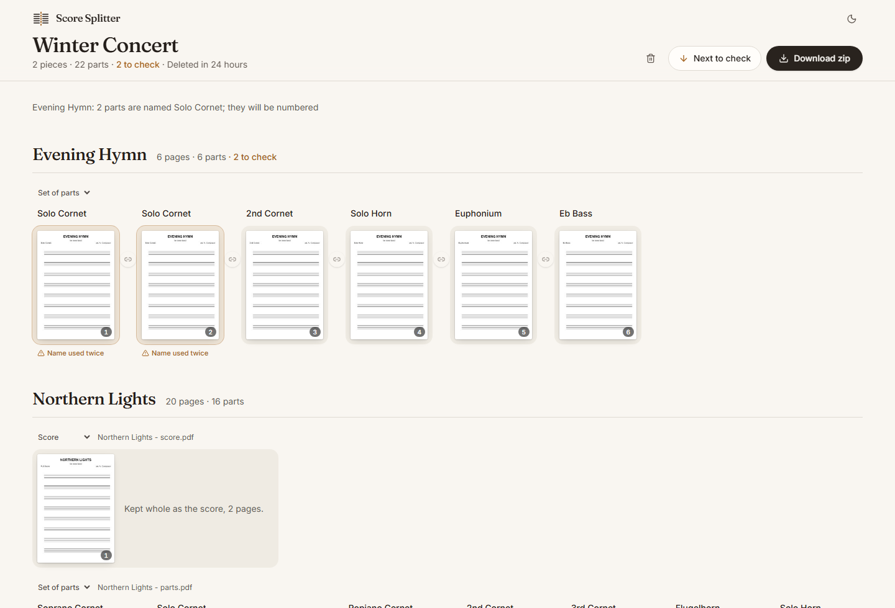

# Score Splitter

Turn the PDFs a band receives for a concert into one PDF per part.

Sheet music for brass bands usually arrives as one long scan per piece, holding
every part in sequence. Score Splitter reads the header of each page, works out
where each part begins, lets you correct what it got wrong, and gives you back
a tidy zip: one folder per piece, one PDF per part, with the same part name in
every piece.



- **Upload** a zip with one folder per piece, or the PDFs of a single piece.
- **Check** the proposed parts as rows of page thumbnails. Rename a part, cut
  it in two, join it to its neighbour, or leave pages out.
- **Download** a zip ready for the band's cloud.

It runs entirely on your own machine. Nothing is sent anywhere, the scans are
never re-encoded, and uploads are deleted after a day.

## Quick start

```bash
docker compose up -d
```

Then open <http://localhost:3210>.

The compose file uses the image `ghcr.io/OWNER/score-splitter`. To build it
yourself instead:

```bash
docker build -t score-splitter .
```

```bash
docker run -d --name score-splitter -p 3210:3000 -v score-splitter-data:/data score-splitter
```

## Deploy on Umbrel with Arcane

1. Install **Arcane** from the Umbrel app store and open it.
2. Create a new project (stack) and paste in the contents of
   [`docker-compose.yml`](docker-compose.yml).
3. Deploy it.
4. Open `http://umbrel.local:3210`.

There is no login. Keep it on your home network, or put it behind something
that adds one before exposing it further.

## Configuration

Set these as environment variables on the container.

| Variable | Default | Meaning |
|---|---|---|
| `MAX_UPLOAD_MB` | `500` | Largest upload accepted. A zip may unpack to four times this. |
| `JOB_TTL_HOURS` | `24` | Uploads and their results are deleted after this long. |
| `OCR_CONCURRENCY` | `2` | Pages read at the same time. Raise it on a machine with more cores. |
| `DATA_DIR` | `/data` | Where uploads are kept until they expire. |
| `PORT` | `3000` | Port the server listens on inside the container. |

## How it finds the parts

Scans have no text, so each page's top quarter is rendered and read with
[Tesseract](https://github.com/naptha/tesseract.js) (English and German).

1. **Which line is the part name?** Part names sit at a page margin; titles
   are centred. A line naming several instruments is a subtitle ("Flugel Horn,
   Horn & Baritone Trio"), not a part.
2. **Which name is it?** The text is matched against a list of instruments,
   ranks and keys, including German names and common misreadings, and mapped to
   one standard name: "Solo Bb Cornet" and "Solo Cornet" both become
   `Solo Cornet`.
3. **Where does a part start?** The first page of every part repeats the
   piece's title block; continuation pages do not. A page showing the title
   block starts a new part, and every page after it belongs to that part until
   the next one. Parts can be any number of pages long.

Things it handles along the way:

- the same part in two keys (`1st Trombone (Bb)` and `1st Trombone (C)`)
- spare copies of a part, which are flagged so you can leave them out
- instruments it does not know, which become `Unbekannt 1`, `Unbekannt 2`, …
  for you to name; the download is held back until you have
- full scores, which are kept whole as `<Piece> - Partitur.pdf`
- pieces that arrive already split, which are only renamed

Anything it is unsure about is outlined in the review screen.

### Teaching it a new name

All names live in [`src/lib/parts/catalog.ts`](src/lib/parts/catalog.ts). Add
the spelling to an instrument's `aliases` (or to `slips` if it is an OCR
misreading), add a line to the table in
[`tests/parts/match.test.ts`](tests/parts/match.test.ts), and run `npm test`.

## Development

Needs Node.js 22 or newer.

```bash
npm install
```

```bash
npm run dev
```

| Command | What it does |
|---|---|
| `npm test` | Unit and API tests (Vitest). |
| `npm run e2e` | Builds the app and drives it in a browser (Playwright). |
| `npm run probe -- <folder>` | Runs detection over a folder of PDFs and prints what it found. Add `--raw` to see the text read from each page. |
| `npm run lint` | ESLint. |

`npm install` downloads the Tesseract language data into `tessdata/` once;
after that nothing needs the network.

Tests never use real sheet music. Pages are generated on the fly
([`tests/helpers/makeScan.ts`](tests/helpers/makeScan.ts)) as image-only PDFs,
so OCR is exercised for real. To tune detection against your own scans, keep
them in `samples/` (git-ignored) and use `npm run probe`.

### Layout

| Path | Contents |
|---|---|
| `src/lib/parts` | Instrument list and name matching |
| `src/lib/detect` | Choosing the part name on a page; grouping pages into parts |
| `src/lib/pdf`, `src/lib/ocr` | Rendering pages, OCR, lossless page copying |
| `src/lib/zip` | Unpacking uploads safely |
| `src/lib/jobs` | Job storage, edit operations, the background pipeline |
| `src/app/api` | HTTP API |
| `src/components` | The interface |

## Releasing

Pushing a tag such as `v1.0.0` builds the image for `amd64` and `arm64` and
publishes it to the GitHub Container Registry
([`.github/workflows/release.yml`](.github/workflows/release.yml)).

## Licence

[MIT](LICENSE)
